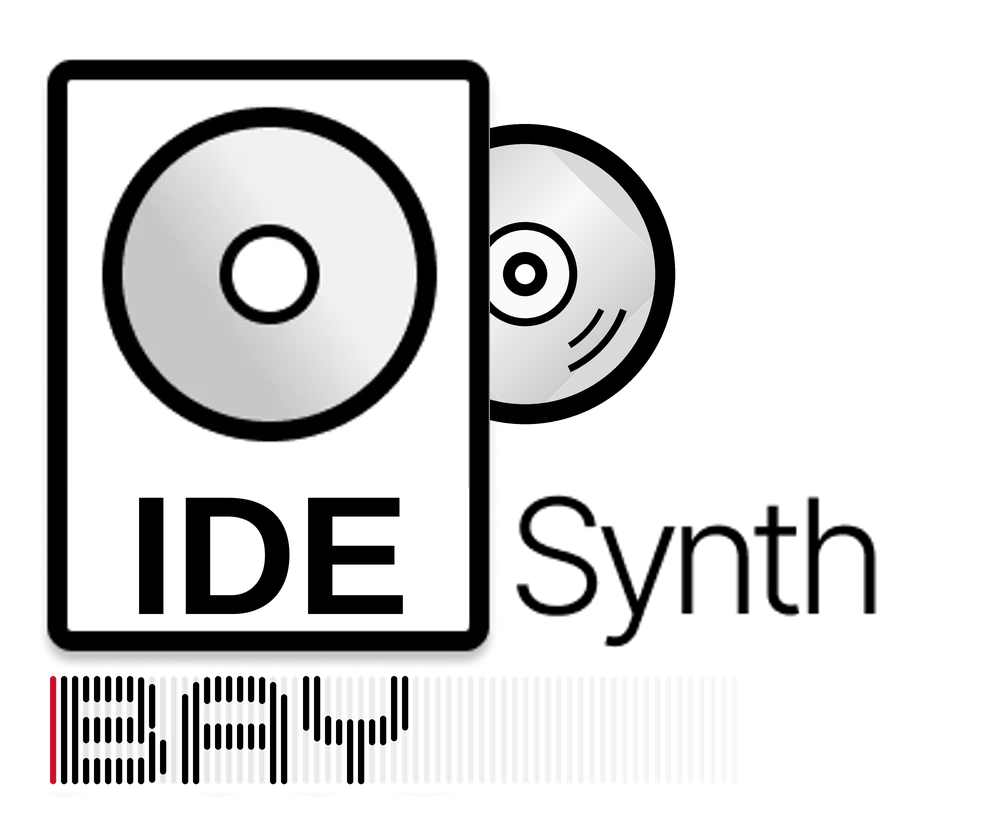
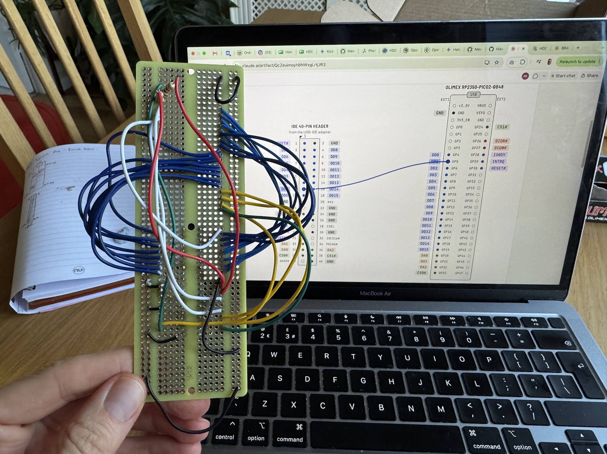
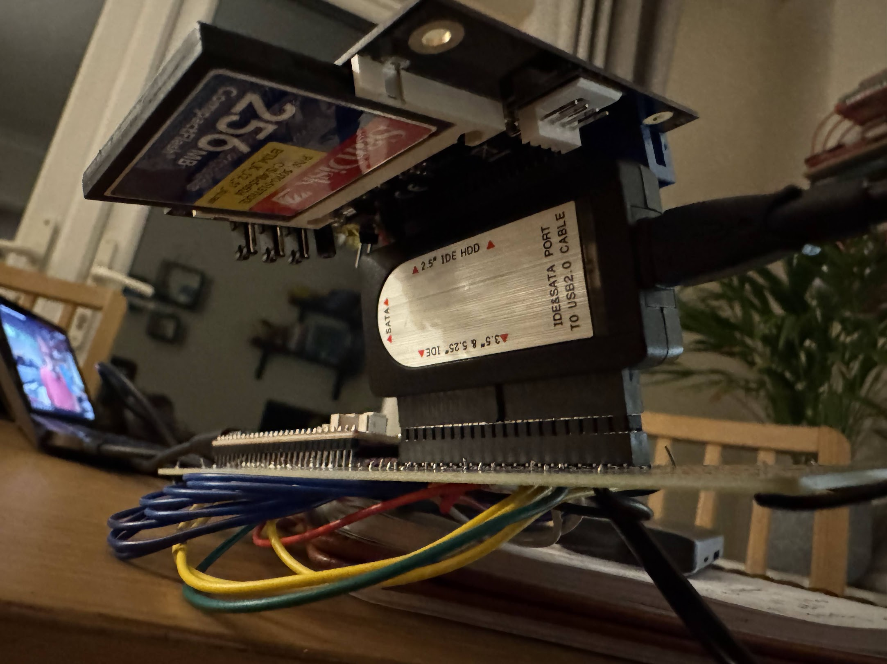
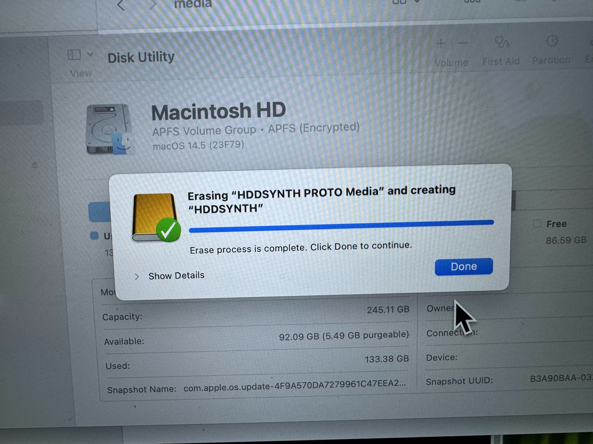
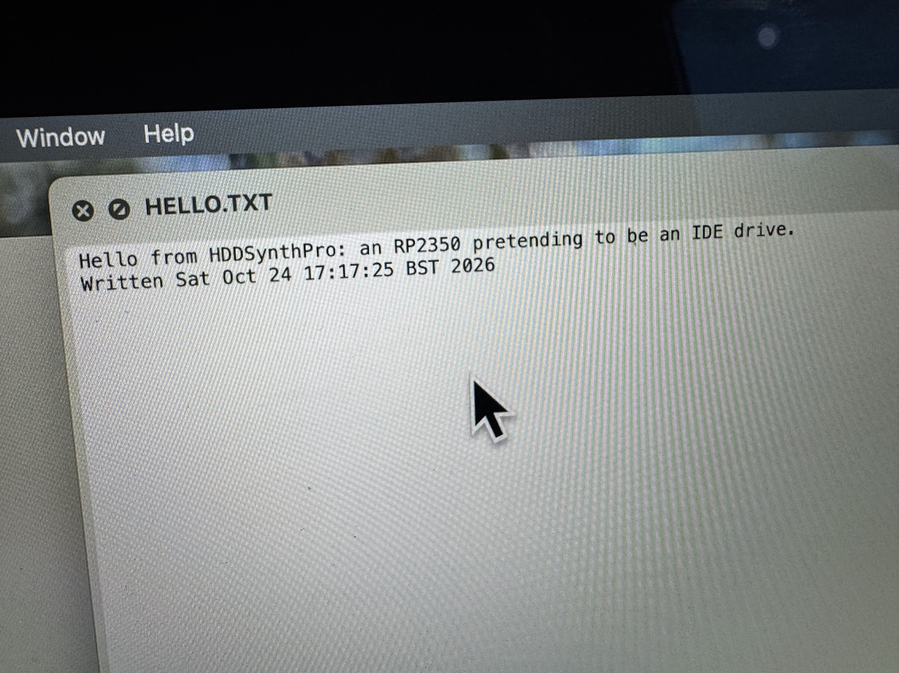

# IDE Synth Bay

[](https://github.com/MaverickUK/HDDSynthPro/actions/workflows/build.yml)
[](https://github.com/MaverickUK/HDDSynthPro/releases)



An RP2350 that pretends to be an IDE hard disk and CD-ROM drive, as the base for a future HDD Synth that *is* the drive rather than one that listens to it.

It started as a proof of concept on an Olimex RP2350-PICO2-BB48 and now has its own PCB. It is tested through USB-IDE adapters from macOS and Windows, and in real retro PCs (see [Testing](#testing)). See [docs/plan.md](docs/plan.md) for the slices and [docs/wiring.md](docs/wiring.md) for the connections. For an interactive wiring diagram, open [docs/wiring.html](docs/wiring.html) in a browser. [docs/bringup.md](docs/bringup.md) is the checklist for hardware day. [docs/pcb-bom.md](docs/pcb-bom.md) sketches the custom PCB that follows the prototype. [docs/activity.md](docs/activity.md) explains how the drive tells sequential from random activity, for more realistic sounds.

Formerly HDD Synth Pro: renamed IDE Synth Bay once it served CD-ROM drives as well as hard disks. The repository, file names and the firmware's own messages keep the old name.

The logo? "BAY" is meant to be an IDE cable, with pin 1 being red :)

<br clear="left">

## Contents

- [Prototyping](#prototyping)
- [Status](#status)
- [Testing](#testing)
  - [Machines](#machines)
  - [Speeds](#speeds)
  - [The benchmark image](#the-benchmark-image)
- [Quick start](#quick-start)
- [Licence](#licence)

## Prototyping





Currently I'm creating a proof of concept on a BB48 dev board that exposes all of the GPIO lines of the RP2350 chip so that I'm able to hook them up to the IDE bus.





Which means it's possible to create an emulated IDE drive mounted on an SD card.

I'm not yet sure if this will exist alongside the original HDD Synth or will supersede it, time will tell

## Status

A working IDE hard disk and CD-ROM drive, serving disk images and ISOs from a microSD card, on the Olimex BB48 and the IDE Synth Bay PCB. The latest release is [v0.35.0](https://github.com/MaverickUK/HDDSynthPro/releases) (tagged on `main`, with the firmware files).

- **It sets itself up:** by default the drive starts in its safest way of answering the bus, learns the PC it's in (an ISA card or not, a controller that waits for IORDY or not), and moves to the fastest way that PC can take, offering DMA once it knows the PC can use it. On the Athlon XP test PC, Windows 98 gets DMA on its first boot with no settings at all ([docs/auto-bus.md](docs/auto-bus.md)).
- **Transfer modes:** PIO 0-3 and multiword DMA 2, with block mode (READ/WRITE MULTIPLE, 8 sectors).
- **Settings:** few. `HDDSYNTH.INI` names the images ([docs/settings.md](docs/settings.md)); the geometry comes from the image's own partition table, so an image of an old drive boots with the BIOS on auto. Without a card it serves a small welcome disk.
- **The HDD Synth link:** the drive tells an HDD Synth what it's doing and where the head goes, so the synth's seeks match the PC's. With `seek_timing = synth` the drive also runs at the pace of the drive the synth is playing, from a 1985 stepper to a 2005 7,200 rpm drive with its cache ([docs/activity-link.md](docs/activity-link.md)).
- **Checked on the cable:** the drive watches its own bus and checks every data word the host takes off it.
- **The SD card's high-speed mode** (the PCB): reads from the card twice as fast, on by default; it checks itself at every start and falls back by itself.
- **Next:** the Pentium 200 and the ICL 386 with the new defaults, a long card soak, PCB rev 0.4 (ordered).

The listen-only build (`pio run -e bb48`) records every IDE register access it sees without driving any pin, for studying what a host does.

## Testing

### Machines

| Machine | IDE controller | What ran | Result |
|---|---|---|---|
| USB-IDE adapters (JMicron; Innostor), from macOS and Windows | The adapter's | The rig's tests, partitioning and formatting, standby and wake; 10-hour soaks in PIO and DMA | Clean: 138 million sectors checked on the cable in the soaks, none bad |
| ICL HRA 386 (1992) | 16-bit ISA card, PIO 0 | MS-DOS 5 from a copy of its own disk; the benchmark and a soak | Works, with `isa = on` and the IOCS16# wire |
| Pentium 200 | Intel PIIX, PIO 3 | Windows 95 from a copy of its own disk, with Windows' own disk driver | Works, with early answers (the PIIX ignores IORDY) |
| Evesham, Athlon XP 2000+ | On the motherboard, PIO 3 and DMA | MS-DOS and the benchmark; Doom from the CD-ROM; Windows 98 SE installed from its CD and run with DMA; the default settings learning the PC; the HDD Synth link | Works (Windows 98 needs `MaxPhysPage` with more than 512 MB of RAM) |
| Amiga 1200 | Gayle | | Doesn't boot yet |

What each machine needed, and the dead ends: [docs/retro-test.md](docs/retro-test.md).

### Speeds

The best figures so far, in MB/s:

| Host | How | Read | Write |
|---|---|---|---|
| Evesham, MS-DOS benchmark | PIO 3, the data lane | **4.30** | 2.03 |
| Evesham, MS-DOS benchmark | PIO 3, early answers, block mode | 2.27 | 1.32 |
| ICL 386, MS-DOS benchmark | PIO 0, ISA card | 1.51 | 0.72 |
| USB-IDE adapter | PIO 3, the register table | 1.69 (Innostor: 2.40) | 1.78 (Innostor: 2.65) |
| USB-IDE adapter | Multiword DMA 2, an image on the card | 6.2-6.6 | 5.8-7.2 |
| USB-IDE adapter | Multiword DMA 2, the built-in test disk (RAM) | 7.70 | 13.9 |

Windows 98 SE on the Evesham, copying 200 MB from the CD-ROM to the hard disk:

| Mode | Time | Speed |
|---|---|---|
| PIO 3 | 4 min 20 s | 0.79 MB/s |
| Multiword DMA 2 | 1 min 16 s | 2.4 MB/s |
| Multiword DMA 2, the card in high-speed mode | **1 min 1 s** | **3.0 MB/s** |

Copying the `C:\WINDOWS` folder within C: (184 MB read and written), with the default settings (the drive learned the PC and offered DMA): 51 s, about 3.6 MB/s each way. With the HDD Synth's 2005 drive setting the pace (`seek_timing = synth`): 55 s, as that drive's cache allowed.

The SD card on its own (the PCB, 4-bit SDIO) reads 9.2 MB/s, or 17.7 in high-speed mode.

Through a USB adapter in PIO, the adapter sets the pace whatever the mode. The retro PCs' DOS figures come from the benchmark image, through the BIOS. Every measurement, with its setup: [docs/speed-log.md](docs/speed-log.md).

### The benchmark image

[tools/bench-image](tools/bench-image) builds `DOSBENCH.IMG`, a 128 MB disk that boots FreeDOS and runs `HDDBENCH`: sequential and random reads and writes through the BIOS, a check of every sector it reads, and a soak. It runs the same way on any 386 or later, so results compare directly between machines.

## Quick start

```sh
test/run_native_tests.sh                 # C++ unit tests (no hardware)
cd host && python3 -m venv .venv && .venv/bin/pip install -r requirements.txt
.venv/bin/pytest -m sim                  # simulator and parser tests (no hardware)

pio run -e bb48_drive -t upload          # build and flash the drive
pio run -t upload                        # or the listen-only build
pio device monitor                       # h help, p pin levels, s stats, S SD card

PIO_ENV=bb48_drive scripts/rig.sh -m slice3   # tests, build, flash, rig test
```

Read the power-order rule in [docs/wiring.md](docs/wiring.md) before connecting the adapter. The SD card's wiring is in [docs/wiring-sd.html](docs/wiring-sd.html).

## Licence

IDE Synth Bay is free software, under the GNU General Public License, version 3 ([LICENSE](LICENSE)), as is [HDD Synth](https://github.com/MaverickUK/HDDSynth_Native). You can use, study, change and share it; if you share a changed version, it must be under the same licence, with its source.

The benchmark image's build downloads [FreeDOS](https://www.freedos.org/), which is GPL too; FreeDOS isn't stored in this repository.
