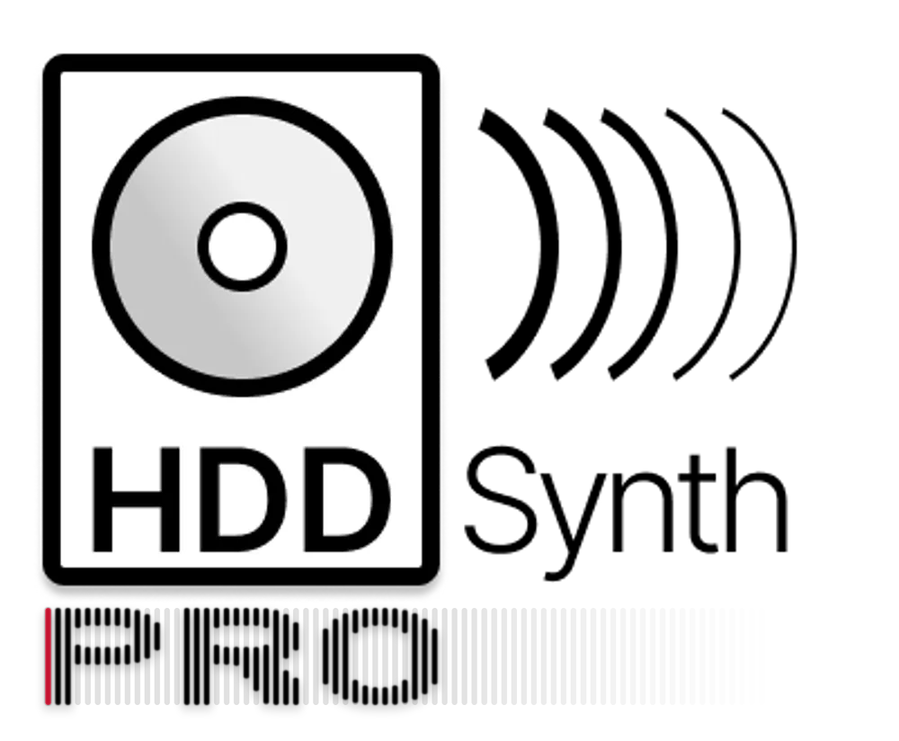
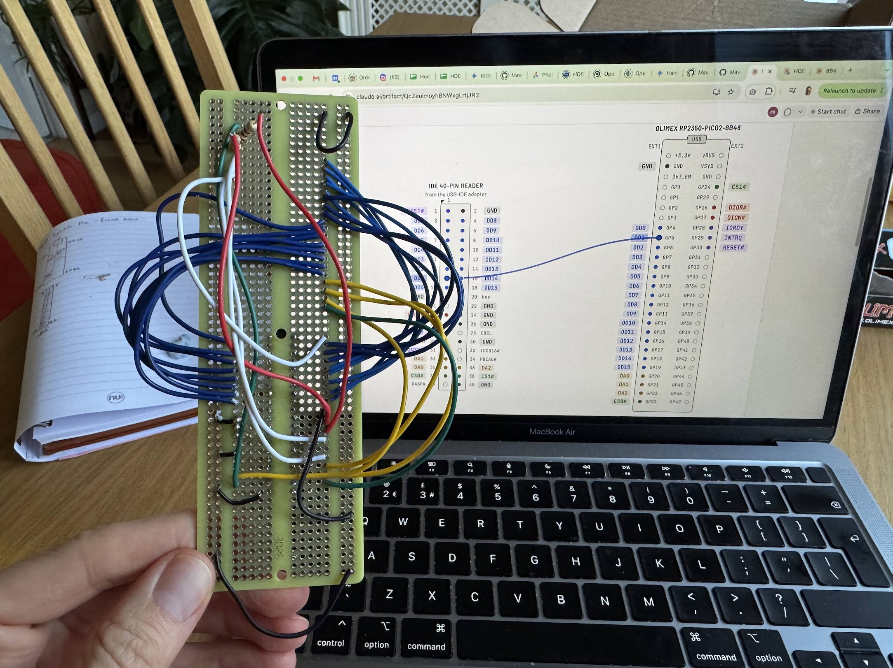
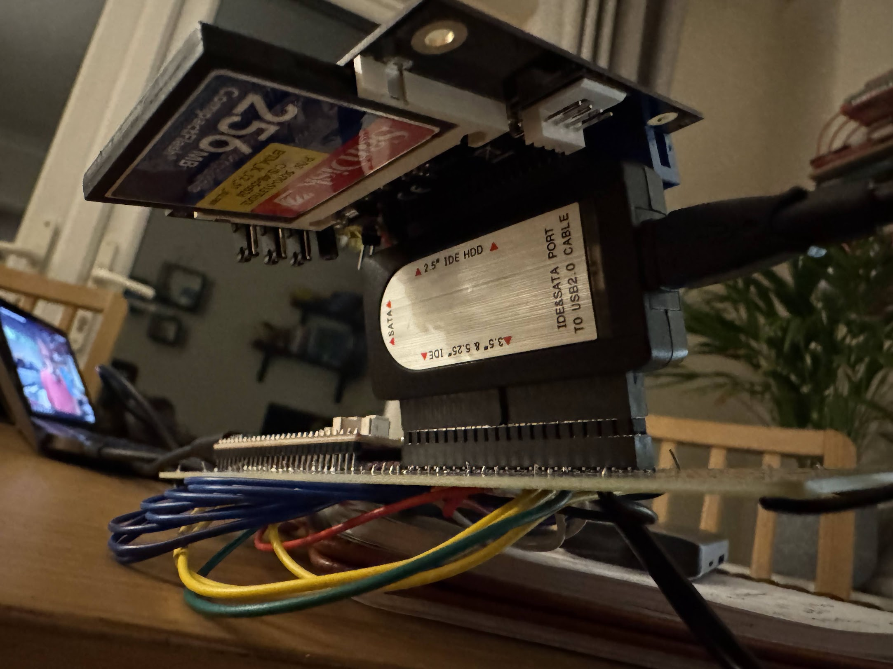
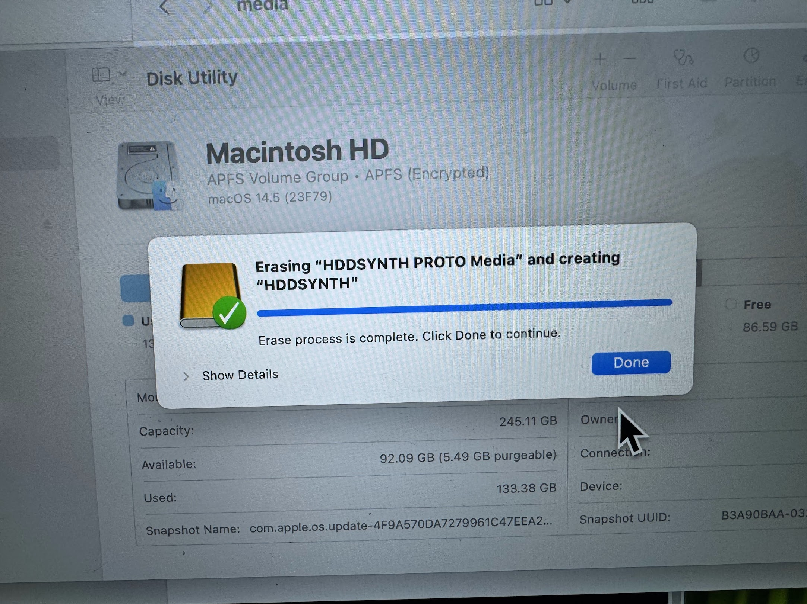
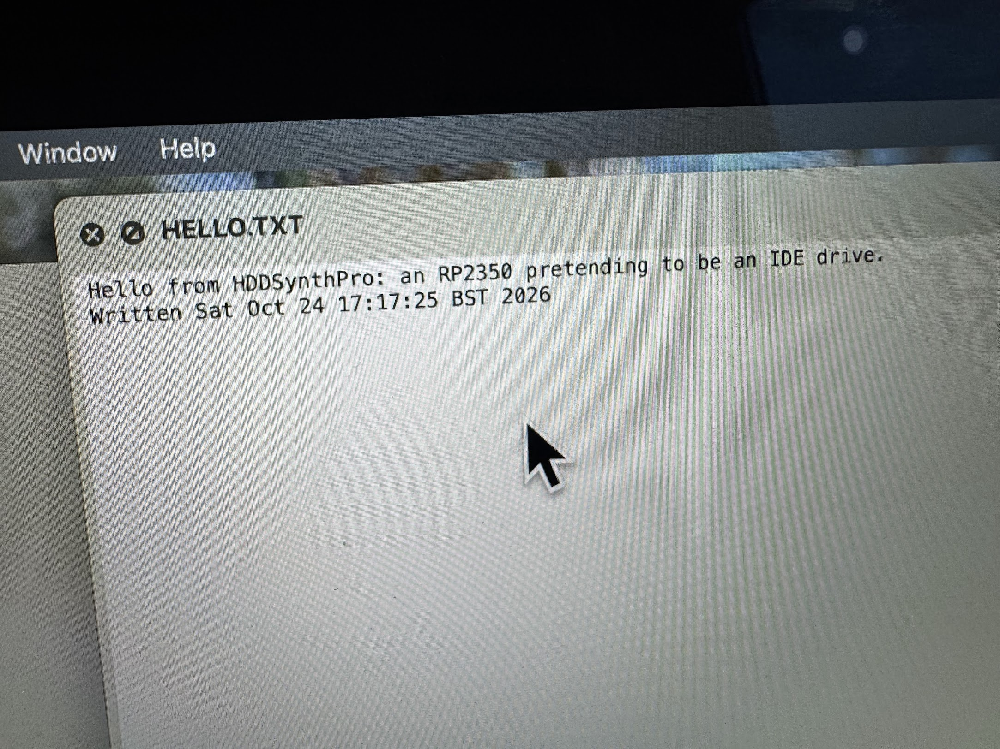

# HDD Synth Pro



An RP2350 that pretends to be an IDE hard disk, as the base for a future HDD Synth that *is* the drive rather than one that listens to it.

At this stage it is a proof of concept on an Olimex RP2350-PICO2-BB48. It is tested through a USB-IDE adapter from macOS and Windows, and in real retro PCs (see [Testing](#testing)). See [docs/plan.md](docs/plan.md) for the slices and [docs/wiring.md](docs/wiring.md) for the connections. For an interactive wiring diagram, open [docs/wiring.html](docs/wiring.html) in a browser. [docs/bringup.md](docs/bringup.md) is the checklist for hardware day. [docs/pcb-bom.md](docs/pcb-bom.md) sketches the custom PCB that follows the prototype. [docs/activity.md](docs/activity.md) explains how the drive tells sequential from random activity, for more realistic sounds.

The logo? The pro part is meant to be an IDE cable, with pin 1 being red :)

<br clear="left">

## Prototyping





Currently I'm creating a proof of concept on a BB48 dev board that exposes all of the GPIO lines of the RP2350 chip so that I'm able to hook them up to the IDE bus.





Which means it's possible to create an emulated IDE drive mounted on an SD card.

I'm not yet sure if this will exist alongside the original HDD Synth or will supersede it, time will tell

## Status

The BB48 works as a read/write IDE hard disk, serving a disk image from a microSD card. It has booted two real retro PCs and soaked for 10 hours at a time behind a USB-IDE adapter. The work is on branch `no-iordy` (0.23.15) until the adapter tests are re-run on it.

- **The drive build** (`pio run -e bb48_drive`) serves `HDDSYNTH.IMG` from a microSD card, or whichever image `HDDSYNTH.INI` names ([docs/settings.md](docs/settings.md)). Without a card it serves a 64 MB welcome disk, with writes kept in RAM until reboot.
- **Transfer modes:** PIO modes 0-3 and multiword DMA mode 2. Hosts that ignore IORDY get early answers (`early_answers = on`), and 16-bit ISA cards get IOCS16# and an IORDY watchdog (`isa = on`).
- **Checked on the cable:** the drive watches its own bus, and checks every data word the host takes off it against what it meant to send.
- **The board's LED** lights for drive activity, as a hard disk's would.
- **Next:** a standard benchmark image to run on every machine, the PCB, and the activity link to the HDD Synth ([docs/activity-link.md](docs/activity-link.md)).

The listen-only build (`pio run -e bb48`) records every IDE register access it sees without driving any pin, for studying what a host does.

## Testing

### Machines

| Machine | IDE controller | Mode used | Firmware | What ran | Result |
|---|---|---|---|---|---|
| USB-IDE adapter (Norelsys NS1081; JMicron ID on Windows), from macOS and Windows | Adapter's own | PIO 0-3, multiword DMA 2 | 0.16-0.18 | Detection and re-detection, partitioning and formatting, the rig tests (slices 0-5), standby and wake, FLUSH CACHE, a card pulled and put back, soaks | 10-hour soaks clean in PIO mode 3 (28.9 GB, 49.5 million sectors checked on the cable, 0 bad) and in DMA (51.9 GB, 89.0 million sectors, 0 bad) |
| ICL HRA 386 (BIOS 1.20, 1992) | 16-bit ISA IDE card | PIO 0 (the card's ISA timing) | 0.22.0, 0.23.15 | Boots MS-DOS 5 from a copy of its own CF card; CHKDSK, copying files. The benchmark image: `HDDBENCH` and a 14-minute soak | Works: the benchmark passed, and the soak checked about 400 MB with 0 bad sectors. Needs the IOCS16# wire (IDE pin 32 to GPIO 2) and `isa = on` |
| Pentium 200 (Intel PIIX, Phoenix BIOS) | PIIX, on the motherboard | PIO 3 (no DMA offered yet) | 0.23.15 | Boots Windows 95 from a copy of its own 4 GB CF card, with Windows' own 32-bit disk driver (`ESDI_506.PDR`) | Works. 163,847 sectors checked on the cable, 0 bad. Needs `early_answers = on`: in its BIOS's timing the PIIX ignores IORDY ([docs/no-iordy.md](docs/no-iordy.md)) |
| Evesham, AMD Athlon XP 2000+, 1 GB, GeForce 2 GTS | On the motherboard | PIO 3 | 0.25.0 | Detected and booted the benchmark image first time; `HDDBENCH` | Works: the benchmark passed, and 43,799 sectors were checked on the cable with 0 bad. `early_answers = on`, though `iordy_ignored` stayed 0 (it waits for IORDY) |

What each machine needed, and the dead ends, are in [CHANGELOG.md](CHANGELOG.md) (0.19-0.23) and [docs/retro-test.md](docs/retro-test.md).

### Speeds

Measured from the host, in MB/s:

| Host | Disk | Mode | Read | Write |
|---|---|---|---|---|
| USB-IDE adapter | built-in test disk (RAM) | PIO 3 | 1.36 | 1.79 |
| USB-IDE adapter | built-in test disk (RAM) | Multiword DMA 2 | 7.70 (1,100 random 4 KB reads/s) | 13.9 |
| USB-IDE adapter | SD card image (SPI) | PIO 0 | 1.31 | 1.61 (write-behind on), 0.94 (off) |
| USB-IDE adapter | SD card image (SPI) | PIO 3 | not measured | 1.65 (write-behind on), 1.05 (off) |
| USB-IDE adapter | SD card image (SPI) | Multiword DMA 2 | not measured | 2.23 (write-behind on) |
| ICL 386 (`DOSBENCH.IMG`, through the BIOS) | SD card image | PIO 0 | 1.51 (random: 1.09 ms a read) | 0.72 |
| Pentium 200 | SD card image | PIO 3 | not measured yet | not measured yet |
| Evesham Athlon XP 2000+ (`DOSBENCH.IMG`, through the BIOS) | SD card image | PIO 3 | 1.81 (random: 0.98 ms a read) | 1.28 |

**Limits on these figures:**
- In PIO the adapter paces itself (about 1.1 µs a word, and 10 ms before each READ), so faster PIO modes can't speed it up; DMA avoids both.
- The SD card over SPI caps image transfers at about 2 MB/s, whatever the mode; SDIO on the PCB should lift that. The Athlon's 1.81 MB/s reads are at that limit.
- The retro PCs' figures come from the benchmark image (below), through the BIOS as DOS uses the disk. The Pentium's run was cut short when its power supply failed, which was unrelated to the drive.

Every step is in [docs/speed-log.md](docs/speed-log.md).

### The benchmark image

[tools/bench-image](tools/bench-image) builds `DOSBENCH.IMG`, a 128 MB disk that boots FreeDOS and runs `HDDBENCH`:
- sequential reads and writes, and random reads, all through the BIOS;
- checks of every sector it reads against a known pattern;
- a soak that runs until a key is pressed.

Each run does the same operations on every machine, so results compare directly between machines. It runs on a 386 or later.

## Quick start

```sh
test/run_native_tests.sh                 # C++ unit tests (no hardware)
cd host && python3 -m venv .venv && .venv/bin/pip install -r requirements.txt
.venv/bin/pytest -m sim                  # simulator and parser tests (no hardware)

pio run -e bb48_drive -t upload          # build and flash the drive
pio run -t upload                        # or the listen-only build
pio device monitor                       # h help, p pin levels, s stats, S SD card

PIO_ENV=bb48_drive scripts/rig.sh -m slice3   # tests, build, flash, rig test
```

Read the power-order rule in [docs/wiring.md](docs/wiring.md) before connecting the adapter. The SD card's wiring is in [docs/wiring-sd.html](docs/wiring-sd.html).

## Licence

To be decided (HDDSynth_Native is GPL-3.0).
