# Architecture

IDE Synth Bay's architecture as [C4](https://c4model.com) diagrams, kept as code in [workspace.dsl](workspace.dsl) ([Structurizr DSL](https://docs.structurizr.com/dsl)). The images below are drawn from it; edit the DSL, not the images.

## The views

### Context: who and what the drive talks to

### Containers: the two cores, the PIO programs, the card, the rig

Core 1 answers the IDE bus in real time and never waits; core 0 does everything slow; the PIO programs meet the bus's nanosecond timing; the cores meet in shared RAM (the fetch mailbox and the trace ring).

### Components

Core 1, the real-time bus loop:

Core 0, the card, the console, the bus = auto advice and the activity link:

The PIO programs, shared out over three blocks by `pio_plan`:

The host-side rig and tools:

### Dynamic views

A READ SECTORS: core 1 never waits for the card; BSY covers the fetch, never IORDY.

`bus = auto` with `dma = auto`: the drive learns the PC, moves to the data lane, then offers multiword DMA ([auto-bus.md](../auto-bus.md)).

### Deployment

The PCB (SDIO card) and the BB48 proof of concept (SPI card):

## Working on it

- **Interactive, with Structurizr's own layout** (better than the Mermaid images here): `docker run -it --rm -p 8080:8080 -v "$PWD/docs/architecture:/usr/local/structurizr" structurizr/structurizr local`, then http://localhost:8080. Drag elements to tidy a view; the layout is saved beside the DSL.
- **After editing the DSL:** `docs/architecture/render.sh` checks it and redraws `mermaid/` and `images/` (Docker: `structurizr/structurizr` and `minlag/mermaid-cli`).
- **Keep it in step with the code:** a new module, program or link between the cores belongs here; the details stay in [CLAUDE.md](../../CLAUDE.md) and the docs it names.
